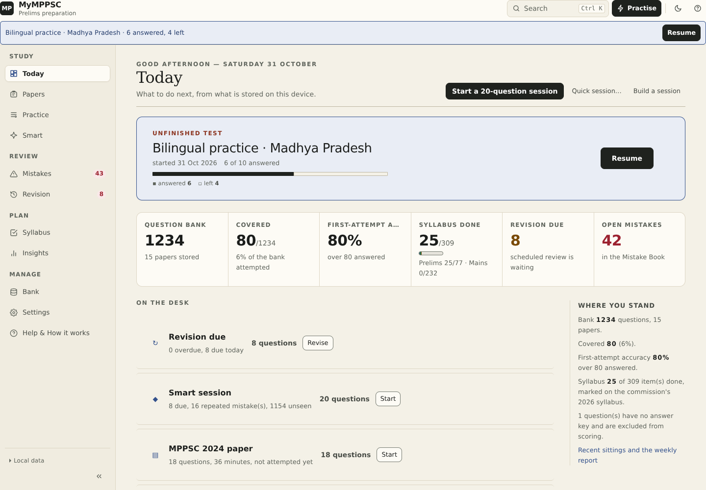
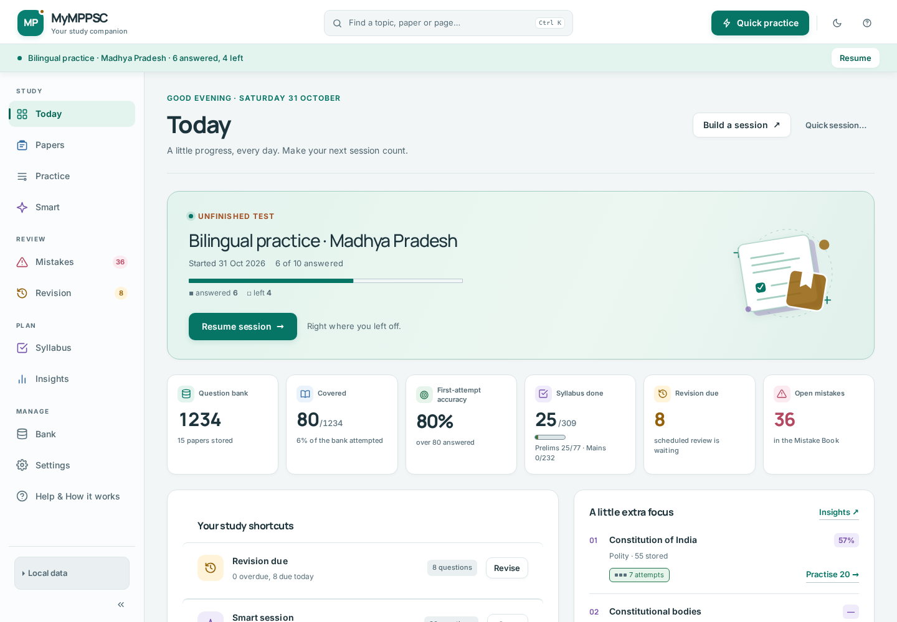
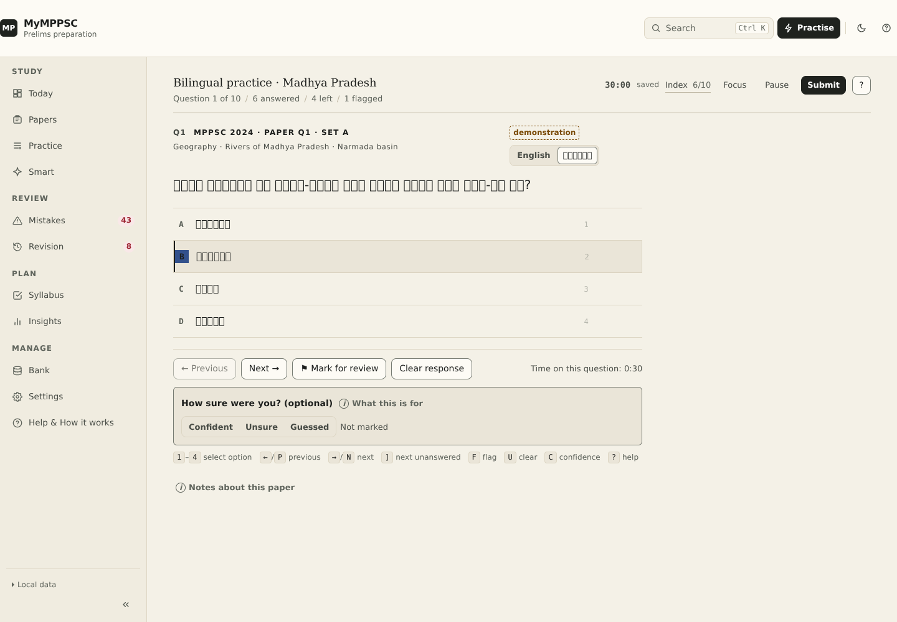
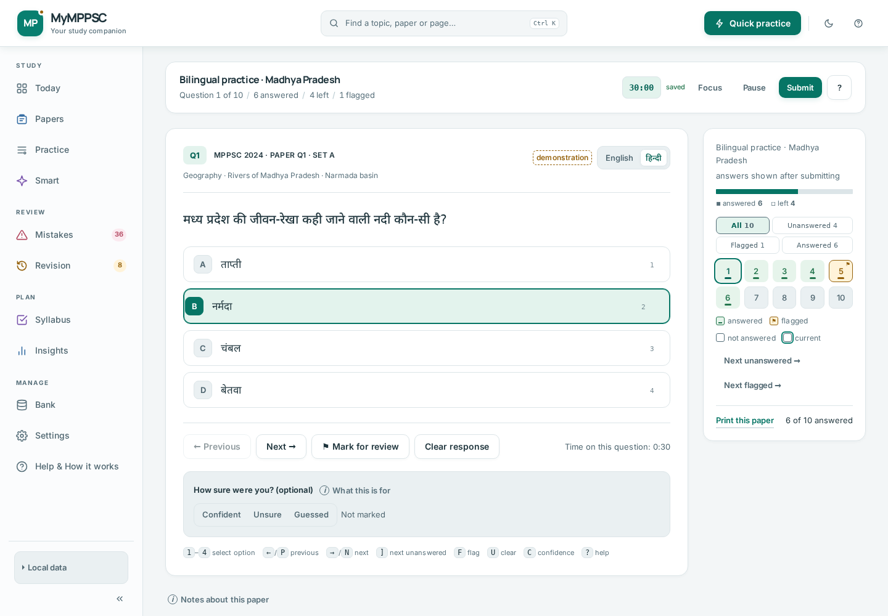

# Study Desk — before / after captures

36 baseline views (`before-*.png`) and 36 refreshed views (`after-*.png`) from the same seeded, disposable local profile. The fixture includes the authentic 1,200-question bank plus the bilingual demonstration bank, four submitted practice sessions, syllabus marks, due revisions and one unfinished bilingual test. Counts are fixture data, not a real reader’s progress.

## Key comparisons

| Screen | Before | After |
| :--- | :--- | :--- |
| Dashboard · light | [before](before-dashboard-light.png) | [after](after-dashboard-light.png) |
| Dashboard · dark | [before](before-dashboard-dark.png) | [after](after-dashboard-dark.png) |
| Dashboard · mobile | [before](before-dashboard-mobile.png) | [after](after-dashboard-mobile.png) |
| Hindi question · light | [before](before-question-hindi-light.png) | [after](after-question-hindi-light.png) |
| Hindi question · dark | [before](before-question-hindi-dark.png) | [after](after-question-hindi-dark.png) |
| Hindi question · mobile | [before](before-question-hindi-mobile.png) | [after](after-question-hindi-mobile.png) |
| Smart Practice | [before](before-smart-light.png) | [after](after-smart-light.png) |
| Syllabus | [before](before-syllabus-light.png) | [after](after-syllabus-light.png) |
| Insights | [before](before-analytics-light.png) | [after](after-analytics-light.png) |
| Report | [before](before-report-light.png) | [after](after-report-light.png) |

## Dashboard

| Before | After |
| :---: | :---: |
|  |  |

## Hindi runner

| Before | After |
| :---: | :---: |
|  |  |

## Full set

- Desktop light/dark: dashboard, test-centre, topic, smart, revision, mistakes, syllabus, analytics, bank, settings, help, Hindi/English runner, report.
- Mobile: dashboard, topic, revision, syllabus, analytics, Hindi runner.
- Tablet: dashboard, topic.

Machine-readable browser verification: [`browser-audit.json`](browser-audit.json). Recapture with `npm run capture:visual`; re-run the browser guard with `npm run audit:visual` (optional `playwright-core` + Chromium required).
